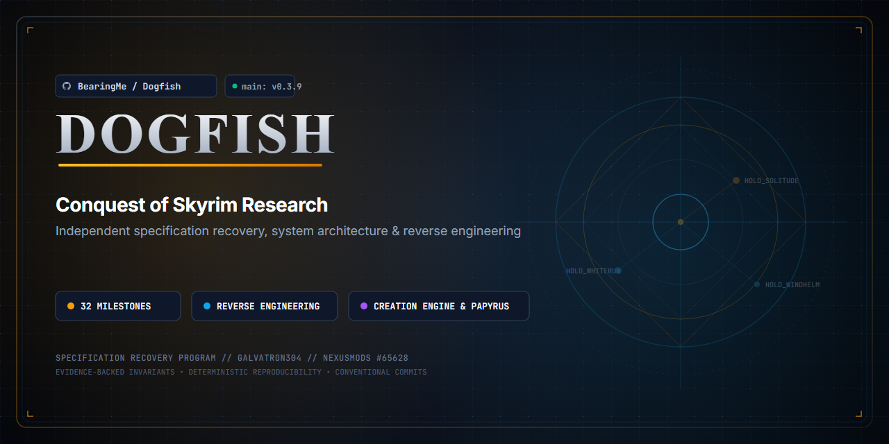

# Dogfish: Skyrim Conquest Research

An exploratory research and specification recovery project centered on **Conquest of Skyrim**, a Skyrim Special Edition mod created by galvatron304 ([Nexus Mods #65628](https://www.nexusmods.com/skyrimspecialedition/mods/65628)).

---

## Introduction

### Project Overview
*Conquest of Skyrim* transforms Skyrim into a grand-strategy experience, introducing complex mechanics for faction management, territorial conquest, army recruitment, warfare, regional politics, and economy into the Creation Engine.

**Dogfish** is a dedicated research initiative designed to systematically investigate, reverse engineer, and document the mod's architecture, underlying systems, technical characteristics, Papyrus scripting, and engine dependencies.

### Project Purpose & Workstreams
The project's purpose is to systematically investigate the mod's architecture, independently reconstruct its strategic systems (faction management, territorial conquest, warfare, politics, and economy) as an executable behavioral reference model, and experimentally probe minimal integration paths into the Skyrim engine runtime.

Work is organized across three interdependent workstreams:
1. **Reconstruction (`reconstruction/`)**: Independent implementation of recovered behavior as a standalone, deterministic simulation model in Rust (`dogfish-reconstruction`, 58 unit, scenario, and hardening tests).
2. **Probing (`references/local/conquest-of-skyrim/Data/`)**: Evidence-driven investigation of original binaries and Papyrus code to extract behavioral contracts and resolve uncertainties.
3. **Integration (`integration/`)**: Experimental interaction with Skyrim's runtime, exploring SKSE, native C-ABI bridges (`dogfish-integration`, 14 tests), and minimal in-game vertical slices.

**Current Status**: Native Integration Hardened & Reconciled (86 Milestones Complete, 12 Planned, 2 Blocked awaiting human in-engine execution across 25 Phases).

---

## For Humans

Welcome, researcher! Human playtesting and manual observation provide the empirical ground truth for this project.

### Your Role
- **Playtesting & Observation**: Playtest *Conquest of Skyrim* across diverse scenarios to observe strategic mechanics, AI behaviors, and faction progression in-game.
- **Bug & Edge-Case Discovery**: Document unintended behaviors, engine stress points, quest conflicts, and script breaking points.
- **Empirical Ground Truth**: Provide empirical reality checks against technical hypotheses generated by AI agents.

### Playtesting Workflow
- **Where to log**: Record gameplay reports and observations under `research/playtesting/`.
- **Reporting Schema**: Follow the standard format defined in [`docs/testing.md`](./docs/testing.md), capturing:
  - Skyrim build and *Conquest of Skyrim* mod version
  - Active load order and starting save state
  - Preconditions and exact reproduction steps
  - Expected vs. observed behavior
  - Result classification (`PASS`, `FAIL`, `BLOCKED`, `INCONCLUSIVE`)
  - Supporting evidence (screenshots, Papyrus logs, save files)
- **Reviewing Findings**: Validate consolidated research summaries in `research/findings/` against actual in-game experiences.

---

## For Agents

All AI agents operating in this workspace must adhere to the structured research workflow established across project documentation.

### Operational Entry Point
- **Read First**: Consult [`AGENTS.md`](./AGENTS.md) and [`CLAUDE.md`](./CLAUDE.md) for overarching repository layout and agent expectations.
- **Research Invariant**: **Research before doing something.** Never guess, hypothesize without labeling, or begin writing gameplay code or speculative implementations.

### Core Capabilities & Tooling
- **Persistent Knowledge with AgentMemory**: Use **AgentMemory** (`plugin:agentmemory:agentmemory` or `research/memory.md` fallback) to store durable facts, discovered engine constraints, and verified technical characteristics. Keep progress checkpoints strictly separate (`research/checkpoints/` or execution checkpoints) as defined in [`docs/execution-discipline.md`](./docs/execution-discipline.md).
- **Reverse Engineering & Clean-Room Boundaries**: Probing with REA (Reverse Engineer Anything / reverse engineering everything) and primary source inspection are authorized within the clean-room boundaries in [`guardrails.md`](./guardrails.md). Original reference files in `references/` remain strictly immutable and read-only.

### Workflow & Discipline Standards
- **Execution & Delegation**: Follow [`docs/execution-discipline.md`](./docs/execution-discipline.md). Maintain strict task boundaries and exclusive file ownership during parallel execution. When `@adversary` is unavailable, perform structured self-review without impersonation.
- **Testing & Scripts**: Follow [`docs/testing.md`](./docs/testing.md). Reusable utilities belong strictly in `scripts/`, automated checks in `tests/`, and generated outputs in `artifacts/` (ignored by Git by default).
- **Logging & Evidence**: Follow [`docs/logging.md`](./docs/logging.md). Use the standard log format `[TIMESTAMP][LEVEL][COMPONENT][MILESTONE] Message`. Extract targeted snippets with provenance from external game engine logs rather than committing large dumps.
- **Reference Management**: Follow [`docs/references.md`](./docs/references.md). Always justify new references, pin exact commit hashes or versions, and maintain the inventory in `references/README.md`.
- **Git Commit Style**: Always use Conventional Commits (`docs:`, `chore:`, `feat:`, `fix:`, `refactor:`, etc.) with atomic, traceable commits and clean working trees.
